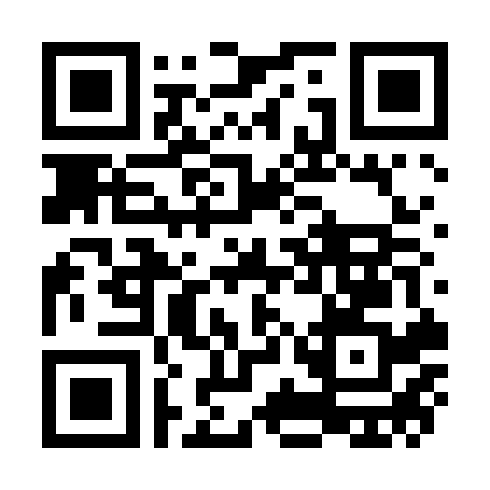

# Anhang F: Die Werkzeug-Quelle

Alle Vorlagen aus diesem Buch stehen als Text-Dateien im Internet,
zum Kopieren statt zum Abtippen. Die Adresse steht unter dem Bild,
der Bild-Code (QR) führt direkt dorthin.

**Die Adresse:** https://github.com/robotfreak/kdp-ki-buch-anhaenge

**Was Sie dort finden:**

- **Anhang A**, die 42 Prompts aus allen zwölf Kapiteln
- **Anhang B**, die Klassen-KI-Charta als Vorlage zum Kopieren
- **Anhang C**, das Gerüst: die zehn Sätze fürs Lehrerzimmer
- **Anhang D**, das Glossar: die 15 Begriffe in Alltagssprache
- **Anhang E**, die DACH-Synopse: die Rechts-Lage in Deutschland, Österreich und der Schweiz

**So nutzen Sie es:** Die Datei öffnen, jeder Prompt steht in einem
grauen Kasten mit Kopier-Knopf (das Kopier-Symbol oben rechts am
Kasten): ein Klick, und der Wortlaut liegt in der Zwischenablage,
fertig zum Einfügen ins KI-Fenster. Die Angaben in eckigen Klammern
ersetzen Sie mit Ihren Werten. Bei eBook-Lesern: das QR-Bild
berühren oder die Adresse abtippen.

Die Vorlagen = gepflegt: wenn eine Form in der Praxis klarer wird,
steht die neue Fassung unter derselben Adresse.
